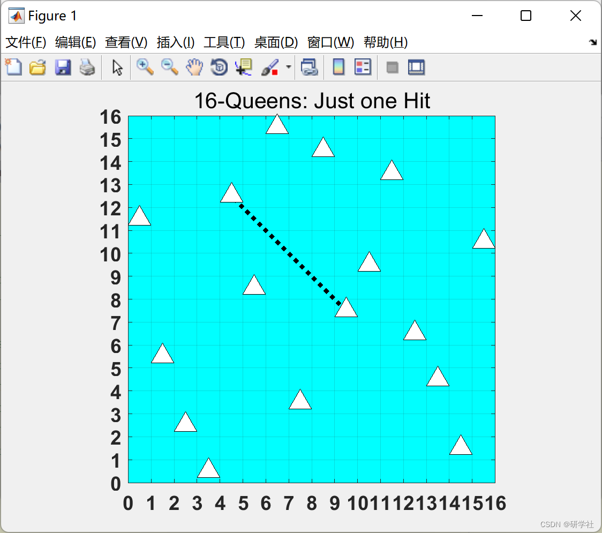
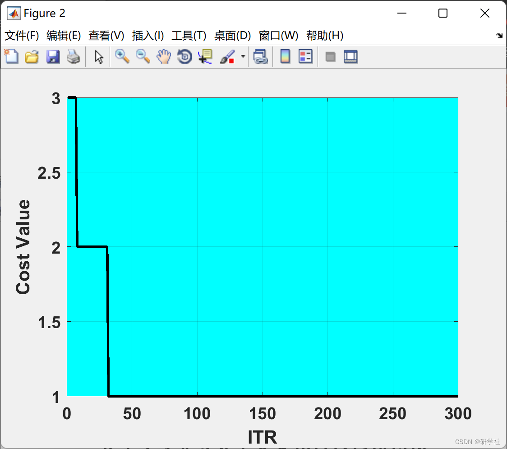

# Optimization Algorithm for Queen's N-Place Problem Based on Weevil Worm Damage (Matlab Code Implementation)

1. Edit
Then, this article solves the TSP problem based on the optimization algorithm for ant damage, implemented in Matlab code.
📚2 Run Results
Edit
Part of the code:
nQueen = 16;
%------------------------------------------------------
CostFunction = @(s) CostF(s);     % Cost Function
nVar = nQueen;            % Decision Variables
VarSize = [1 nVar];          % Decision Variables Matrix Size
VarMin = 0;              % Lower Bound of Variables
VarMax = 1;              % Upper Bound of Variables
%% WDOA Parameters
MaxIt = 300;     % Maximum Number of Iterations
nPop = 200;      % Number of weevils
DamageRate = 0.3;         % Damage Rate
nweevil = round(DamageRate*nPop); % Number of Remained weevils
nNew = nPop-nweevil;        % Number of New weevils
mu = linspace(1, 0, nPop);     % Mutation Rates  
pMutation = 0.2;          % Mutation Probability  
MUtwo = 1-mu;           % Second Mutation  
SnoutPower = 0.8;         % Weevil Snout power Rate  
FlyPower = 0.03*(VarMax-VarMin);  % Weevil Fly Power Rate  
%% Basics  
% Empty weevil  
weevil.Position = [];  
weevil.Cost = [];  
weevil.Sol = [];  
% Weevils Array  
pop = repmat(weevil, nPop, 1);  
% First weevils  
for i = 1:nPop  
pop(i).Position = unifrnd(VarMin, VarMax, VarSize);  
[pop(i).Cost pop(i).Sol] = CostFunction(pop(i).Position);  
end;  
% Sort  
[~, SortOrder] = sort([pop.Cost]);pop = pop(SortOrder);  
% Best Solution  
BestSol = pop(1);  
% Best Costs Array  
BestCost = zeros(MaxIt, 1);  
%--------------------------------  
%% WDOA Body  
for it = 1:MaxIt  
newpop = pop;  
for i = 1:nPop  
for k = 1:nVar  
if rand <= MUtwo(i)  
TMP = mu;TMP(i) = 0;TMP = TMP/sum(TMP);  
j = RouletteWheelS(TMP);  
newpop(i).Position(k) = pop(i).Position(k)+SnoutPower*(pop(j).Position(k)-pop(i).Position(k));  
end;  
% Mutation  
if rand <= pMutation  
newpop(i).Position(k) = newpop(i).Position(k)+FlyPower*randn;  
end;end;  
% Apply Lower and Upper Bound Limits  
newpop(i).Position = max(newpop(i).Position, VarMin);  
newpop(i).Position = min(newpop(i).Position, VarMax);  
[newpop(i).Cost newpop(i).Sol] = CostFunction(newpop(i).Position);  
end;% Asses power  
[~, SortOrder] = sort([newpop.Cost]);newpop = newpop(SortOrder);% Sort  
pop = [pop(1:nweevil);newpop(1:nNew)];% Select  
[~, SortOrder] = sort([pop.Cost]);pop = pop(SortOrder);% Sort  
BestSol = pop(1);% Update  
BestCost(it) = BestSol.Cost;% Store  
% Iteration  
disp(['In Iteration No ' num2str(it) ': WDOA Best Cost = ' num2str(BestCost(it))]);  
figure(1);  
ShowRes(BestSol.Sol);  
if BestCost(it)==0  
break;  
end  
end  
%% ITR  
figure;  
plot(BestCost,'k', 'LineWidth', 2);  
xlabel('ITR');  
ylabel('Cost Value');  
ax = gca;  
ax.FontSize = 14;  
ax.FontWeight='bold';  
set(gca,'Color','c')  
grid on;  
🎉3 References
🌈4 Matlab code and article reading

## Images

<!-- PAYMENT_BLOCK -->

## Get this dataset

- Payment link (Stripe): [Buy now](https://buy.stripe.com/3cs8yP7sY87d0vu9AB)
- Payment QR code: 

<!-- /PAYMENT_BLOCK -->
